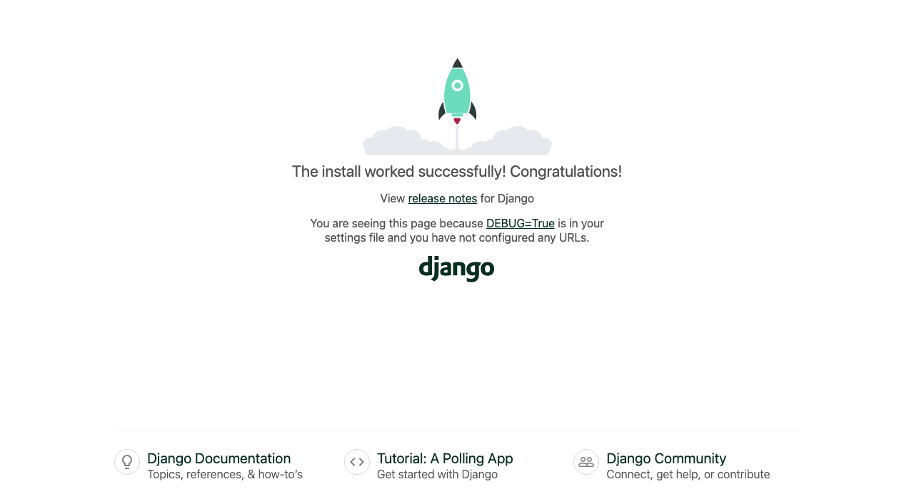

# 02 — Start the Django project

**Mission:** create the project, create two apps, and install the three extras the site needs.
**Time:** about 30 minutes
**You will have when you finish:** an empty Django project that runs, with folders ready.

---

## Before you start

- Your command prompt shows `(.venv)` at the start
- You are inside your project folder

If not, go back to [Guide 01](01-set-up-your-environment.md).

---

## Step 1 — Create the project

```bat
django-admin startproject config .
```

The `.` at the end matters — it means *"put the files in the current folder"*,
rather than making another folder inside it.

**Checkpoint.** VS Code's file list now shows:

```
bytebarn/
├── manage.py
└── config/
    ├── __init__.py
    ├── settings.py
    ├── urls.py
    └── wsgi.py
```

> **Why is the project called `config` and not `bytebarn`?**
> Because `config` is the folder of *settings*. Renaming it to `bytebarn` would
> mean typing `bytebarn.settings` everywhere, and `config` is what almost every
> Django tutorial uses, so your code will match other code you find online.

---

## Step 2 — Create the two apps

An **app** is a folder of related code. We make two: one for shopping, one for
customers.

```bat
python manage.py startapp shop
python manage.py startapp accounts
```

**Checkpoint.** Two new folders. Each contains `models.py`, `views.py`,
`tests.py`, `admin.py` and a `migrations` folder.

> **Project versus app.** The *project* is `config` — it holds settings and the
> master list of URLs. The *apps* hold the actual features. A real site has many
> apps; this one has two, which is plenty.

---

## Step 3 — Install the extras

Three more things to install, all with `pip`:

```bat
python -m pip install django-crispy-forms crispy-bootstrap5
```

| Package | What it does |
|---------|--------------|
| `django-crispy-forms` | Renders Django forms with Bootstrap styling instead of plain HTML |
| `crispy-bootstrap5` | The Bootstrap 5 flavour of that |

Bootstrap itself we load from a **CDN** in the HTML later (a `<link>` tag
pointing at a website), so there is nothing to install for it. If the school
network blocks the CDN, see [If something goes wrong](#if-something-goes-wrong) at
the bottom.

Now save the list of packages so anyone can rebuild this environment:

```bat
python -m pip freeze > requirements.txt
```

Open `requirements.txt`. It will list a lot. That is fine — that is exactly what
`pip install -r requirements.txt` needs later.

---

## Step 4 — Tell Django about the apps

Open `config/settings.py`.

### 4a. Add the apps and crispy to `INSTALLED_APPS`

Find the list that starts with `"django.contrib.admin",` and replace the whole
list with this:

```python
INSTALLED_APPS = [
    "django.contrib.admin",
    "django.contrib.auth",
    "django.contrib.contenttypes",
    "django.contrib.sessions",
    "django.contrib.messages",
    "django.contrib.staticfiles",

    # Our own apps
    "shop.apps.ShopConfig",
    "accounts.apps.AccountsConfig",

    # Crispy forms (renders our Django forms as Bootstrap 5 forms)
    "crispy_forms",
    "crispy_bootstrap5",
]
```

### 4b. Point Django at our templates folder

Inside `TEMPLATES`, find `"DIRS": [],` and change it to:

```python
"DIRS": [BASE_DIR / "templates"],
```

> **`BASE_DIR` is the project root.** `BASE_DIR / "templates"` means *"the
> templates folder next to manage.py"*. Without this line Django would not know
> where to look for HTML.

### 4c. Tell Django where our static files live

Find `STATIC_URL = "static/"` and add under it:

```python
# STATIC_URL is the web address Django gives your files:
#     /static/css/style.css
#
# STATICFILES_DIRS is where those files actually live on your computer.
# Without this line, Django looks inside each app's own static/ folder and
# never finds our project-wide one -- and every image comes back as a 404.
STATICFILES_DIRS = [BASE_DIR / "static"]
```

> **This one catches everybody.** A new Django project does not serve a
> top-level `static/` folder unless you ask it to. Miss this line and every
> image and stylesheet on the site returns **404 Not Found** while the pages
> still look *almost* right.

### 4d. Add the login and shop settings

Go to the very bottom of `settings.py` and paste this on after
`DEFAULT_AUTO_FIELD`:

```python
# --- Login and logout --------------------------------------------------------
# Where Django sends people when a view needs a logged-in user, and where they
# land after logging in or out.

LOGIN_URL = "login"
LOGIN_REDIRECT_URL = "accounts:dashboard"
LOGOUT_REDIRECT_URL = "shop:home"


# --- Crispy forms ------------------------------------------------------------
# Which Bootstrap version crispy should render HTML for.

CRISPY_ALLOWED_TEMPLATE_PACKS = "bootstrap5"
CRISPY_TEMPLATE_PACK = "bootstrap5"


# --- Our shop settings -------------------------------------------------------
# Change the currency symbol here and every template updates itself.

SHOP_CURRENCY = "£"
```

### 4e. Soften the password rules (classroom only)

Find `AUTH_PASSWORD_VALIDATORS` and replace it with:

```python
AUTH_PASSWORD_VALIDATORS = [
    # We keep just these two so a classroom demo is not blocked by
    # "your password is too similar to your username". Put the other two back
    # in if you are building something you actually want to protect.
    {
        "NAME": "django.contrib.auth.password_validation.MinimumLengthValidator",
        "OPTIONS": {
            "min_length": 8,
        },
    },
    {
        "NAME": "django.contrib.auth.password_validation.NumericPasswordValidator",
    },
]
```

> **While you are in there**, also change `LANGUAGE_CODE = "en-us"` to
> `"en-gb"` and `TIME_ZONE = "UTC"` to `"Europe/London"`.

---

## Step 5 — Make the folders

Create these by hand in VS Code (right-click → New Folder):

```
templates/
static/
  css/
  js/
  img/
docs/
```

`templates` holds the HTML. `static` holds CSS, JavaScript and images. They are
empty for now — you will fill them in over the next few guides.

---

## Step 6 — Run it

```bat
python manage.py runserver
```

**Checkpoint.** You get:

```
Watching for file changes with StatReloader
Performing system checks...

System check identified no issues (0 silenced).

You are now running Django's development server at http://127.0.0.1:8000/
Quit the server with CTRL-BREAK.
```

Open <http://127.0.0.1:8000/> in your browser.

**Checkpoint.** You see the plain Django welcome page, with a rocket and the words
*"The install worked successfully!"*, plus links to *Django admin* and
*Django documentation*.



That page is a good sign. Django is running and serving pages.

> **Leave the server running.** Open a second command prompt for everything
> else — one tab running the server, one tab for commands. You only need to
> restart it when you change something in `settings.py` or `urls.py`. Changes to
> views, templates and CSS are picked up automatically.

---

## Step 7 — Check the project is healthy

Run these one at a time. All three should be quiet or cheerful.

```bat
python manage.py check
```

```
System check identified no issues (0 silenced).
```

```bat
python manage.py makemigrations
```

```
No changes detected
```

```bat
python manage.py test
```

```
Ran 0 tests in 0.001s

OK
```

Zero tests is correct — there are no tests yet. You will write some in Guide 14.

---

## If something goes wrong

**`command 'django-admin' is not recognized`**
Your virtual environment is off. Run `.venv\Scripts\activate` and try again.

**`Error: That port is already in use`**
Something else is using port 8000 — usually a `runserver` you forgot about. Use
a different port: `python manage.py runserver 8001`.

**`You have N unapplied migration(s)`**
Run `python manage.py migrate`. It is harmless and you will do it constantly.

**`Invalid models` or `Cannot find config` errors after editing settings**
Usually a missing comma or an unmatched bracket. Python is telling you the line
number — go and look at it.

**Images and CSS return 404**
You skipped 4c. Add `STATICFILES_DIRS`.

**Bootstrap styles are not loading**
That is Guide 03 — Bootstrap is not in your HTML yet.

**The CDN is blocked by your school network**
Ask about it first; if there is no fix, the CDN link in the next guide can be
replaced with a local copy. Do not worry about it yet.

---

## Mission complete

- [ ] `config/` exists and contains `settings.py`
- [ ] `shop/` and `accounts/` exist
- [ ] `python manage.py check` reports no issues
- [ ] <http://127.0.0.1:8000/> shows the Django welcome page
- [ ] `requirements.txt` exists
- [ ] `templates/`, `static/css`, `static/js` and `static/img` exist
- [ ] You have committed

**Commit:** `git add .` then `git commit -m "Guide 02: project and apps created"`

---

Next: [03 — Your first template](03-your-first-template.md)