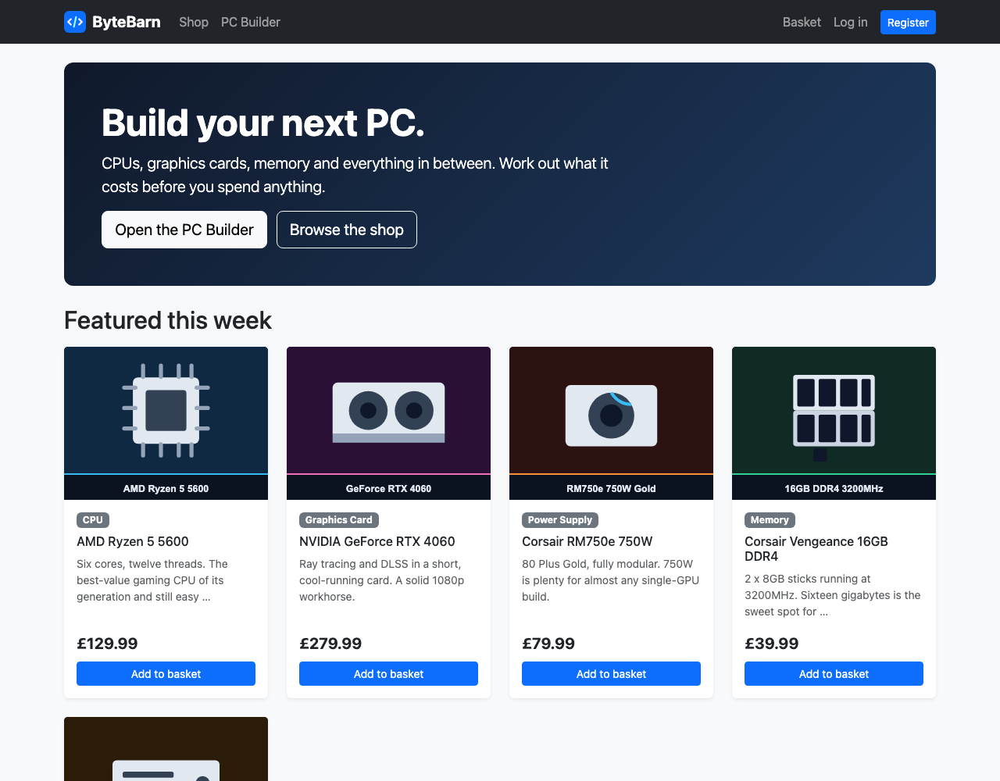
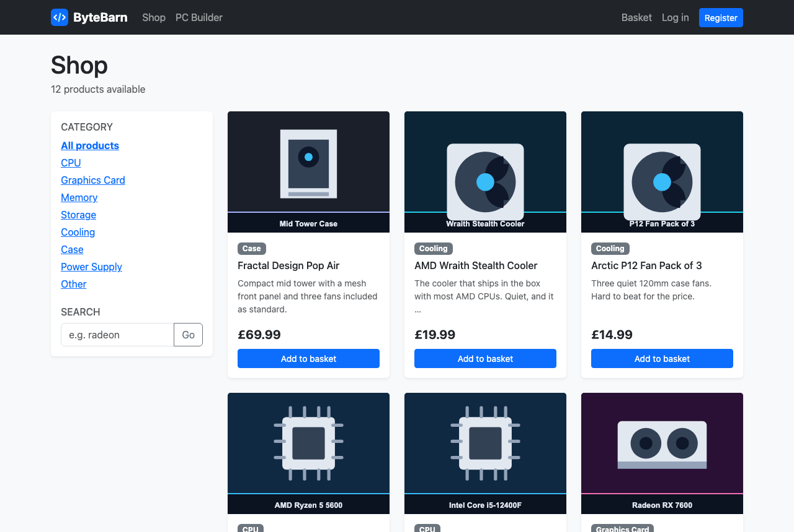

# 07 — Product cards and filters

**Mission:** build the shop page — a grid of product cards, a category filter and a search box.
**Time:** about 45 minutes
**You will have when you finish:** the shop page working, with filters that need no JavaScript.

---

## Before you start

- Guide 06 is finished, so you have products in the database
- You commented out the Shop link in the navbar in Guide 04 — we will put it back

---

## Step 1 — The view

Open `shop/views.py`. Add this below `home()`:

```python
def product_list(request):
    """The shop window: every product, with filters."""
    products = Product.objects.filter(stock__gt=0)

    # These come from the query string, e.g. /shop/?category=gpu&q=radeon
    selected_category = request.GET.get("category", "")
    query = request.GET.get("q", "").strip()

    if selected_category:
        products = products.filter(category=selected_category)
    if query:
        products = products.filter(name__icontains=query)

    context = {
        "products": products,
        "categories": Product.CATEGORY_CHOICES,
        "selected_category": selected_category,
        "query": query,
    }
    return render(request, "shop/product_list.html", context)
```

### Reading it top to bottom

| Line | Meaning |
|------|---------|
| `Product.objects.filter(stock__gt=0)` | every product with stock above zero |
| `request.GET.get("category", "")` | read `?category=gpu` from the address, or `""` |
| `products.filter(category=selected_category)` | narrow the query |
| `name__icontains=query` | "contains, ignoring case" |
| the `context` dictionary | data for the template |

> **`__` is read as "of".** `stock__gt` = *the stock of this product is greater
> than*. `name__icontains` = *the name of this product contains*. The double
> underscore is how Django joins a field name to a lookup. You will see it
> constantly: `__lt`, `__gte`, `__in`, `__startswith`.

> **A QuerySet is lazy.** `products.filter(...)` has not talked to the database
> yet. It waits until you use it — in the template, or by calling `.count()`.
> That is why adding a filter does not get slower as you add more filters.

Add the import at the top of `views.py` if it is not there:

```python
from .models import Product
```

---

## Step 2 — The URL

In `shop/urls.py`:

```python
urlpatterns = [
    path("", views.home, name="home"),
    path("shop/", views.product_list, name="product_list"),
]
```

Put `"shop/"` **above** any catch-all pattern. Django reads the list top to
bottom and stops at the first match.

Now uncomment the Shop link in `base.html`:

```html
<a class="nav-link" href="">Shop</a>
```

---

## Step 3 — One card, saved as a reusable piece

We need the same card on the home page and the shop page. Rather than write it
twice, make it a separate template you can drop in anywhere.

Create `templates/shop/_product_card.html` — note the **underscore** at the
start, which marks it as a partial:

```html


One product card.

Included by both the home page and the shop page, so if you want to change how a
card looks you only change it here, not in two different files.

Use it with:
    


<div class="card product-card shadow-sm border-0 h-100">
  <a href="{{ product.get_absolute_url }}">
    
      
    
      <div class="card-img-top d-flex align-items-center justify-content-center text-body-secondary">
        No image
      </div>
    
  </a>
  <div class="card-body d-flex flex-column">
    <span class="badge text-bg-secondary align-self-start mb-2">{{ product.get_category_display }}</span>
    <h5 class="card-title h6">
      <a href="{{ product.get_absolute_url }}" class="text-decoration-none text-body">{{ product.name }}</a>
    </h5>
    <p class="card-text small text-body-secondary">{{ product.description|truncatewords:14 }}</p>
    <p class="fw-bold fs-5 mb-2">{{ currency }}{{ product.price }}</p>
    <button class="btn btn-primary btn-sm w-100 mt-auto" type="button">Add to basket</button>
  </div>
</div>
```

> **``** hides text from the output. It is a good place to explain
> code without cluttering the page.
>
> **The leading underscore** on `_product_card.html` is a convention meaning
> "this is a fragment, not a page". Django does not care, but you will.

### Three clever bits

**`{{ product.get_category_display }}`** — we never wrote that. Django makes it
automatically from `choices=["cpu", "CPU", ...]`: it stores `"cpu"` and displays
`"CPU"`.

**`{{ product.description|truncatewords:14 }}`** — the `|` is a **filter**. It
takes the value on the left, does something, prints the result. This one cuts
long descriptions to 14 words and adds `…`.

**`{{ currency }}`** — from the context processor in `shop/context_processors.py`
(you will write that in this guide, Step 6). One setting controls the symbol on
every page.

---

## Step 4 — The shop page template

Create `templates/shop/product_list.html`:

```html



Shop — ByteBarn


<h1 class="page-title">Shop</h1>
<p class="text-body-secondary mb-4">{{ products|length }} product{{ products|length|pluralize }} available</p>

<div class="row g-4">
  <!-- ============ Filter sidebar ============ -->
  <div class="col-lg-3">
    <div class="card border-0 shadow-sm">
      <div class="card-body">
        <h2 class="h6 text-uppercase text-body-secondary">Category</h2>
        <ul class="list-unstyled mb-4">
          <li class="mb-1">
            <a href=""
               class="fw-bold text-primary">
              All products
            </a>
          </li>
          
            <li class="mb-1">
              <a href="?category={{ value }}"
                 class="fw-bold text-primary">
                {{ label }}
              </a>
            </li>
          
        </ul>

        <h2 class="h6 text-uppercase text-body-secondary">Search</h2>
        <form method="get" action="">
          <div class="input-group">
            <input type="text" name="q" class="form-control" placeholder="e.g. radeon" value="{{ query }}">
            <button class="btn btn-outline-secondary" type="submit">Go</button>
          </div>
        </form>
      </div>
    </div>
  </div>

  <!-- ============ Product grid ============ -->
  <div class="col-lg-9">
    
      <div class="row row-cols-1 row-cols-sm-2 row-cols-xl-3 g-4">
        
          <div class="col">
            
          </div>
        
      </div>
    
      <div class="empty-state p-5 text-center text-body-secondary">
        <h2 class="h5">Nothing matches that.</h2>
        <p>Try a different category, or clear the search box.</p>
        <a href="" class="btn btn-outline-secondary btn-sm">Show everything</a>
      </div>
    
  </div>
</div>

```

### The important parts

**``** — loop over every product. Everything until
`` repeats.

**``** — if the list is empty, show a helpful message instead of
a blank area. Always handle the empty case; it is half of good user interfaces.

**``** — drop the
card in, handing it a variable called `product`. The file uses `product` inside
and has no idea where it came from.

**`href="?category={{ value }}"`** — note there is no page name here. A link
starting with `?` means *"stay on this page, but change the query string"*.
Clicking it sends the browser to `/shop/?category=gpu`. No JavaScript, no page
reload of the whole layout.

**``** — unpacking a tuple into two names.
We looped over the field's choices, so the sidebar can never get out of step with
the model.

---

## Step 5 — Put the cards on the home page too

Update `templates/shop/home.html`:

```html



ByteBarn — PC parts without the guesswork


<div class="hero p-4 p-lg-5 mb-4">
  <h1 class="display-5 fw-bold">ByteBarn</h1>
  <p class="lead mb-3">
    CPUs, graphics cards, memory and everything in between. Work out what it
    costs before you spend anything.
  </p>
  <a href="#" class="btn btn-light btn-lg me-2">Open the PC Builder</a>
  <a href="" class="btn btn-outline-light btn-lg">Browse the shop</a>
</div>

<h2 class="mb-3">Featured this week</h2>


  <div class="row row-cols-1 row-cols-sm-2 row-cols-lg-4 g-4">
    
      <div class="col">
        
      </div>
    
  </div>

  <div class="empty-state p-5 text-center text-body-secondary">
    <p class="mb-1">No products yet.</p>
    <p class="mb-0">Load the sample data with <code>python manage.py seed_shop</code>.</p>
  </div>


```

And make `home()` in `views.py` show only featured products:

```python
def home(request):
    """The landing page. Shows a handful of featured products."""
    products = Product.objects.filter(featured=True, stock__gt=0)
    return render(request, "shop/home.html", {"products": products})
```

> **Two filters, one query.** `Product.objects.filter(featured=True, stock__gt=0)`
> means *featured* **and** *in stock*. Commas mean AND. Use `|` for OR:
> `filter(featured=True) | filter(featured=False)` finds everything.

---

## Step 6 — The currency on every page

Right now `{{ currency }}` is empty, so prices show as `129.99`. Fix it once,
for the whole site.

Create `shop/context_processors.py`:

```python
from django.conf import settings
from .cart import cart_count


def shop(request):
    """Extra bits of information that every single template needs.

    Adding a context processor here means the basket badge works on every page
    without us passing anything into each view by hand.
    """
    return {
        "cart_count": cart_count(request),
        "currency": settings.SHOP_CURRENCY,
    }
```

Then tell Django about it. In `config/settings.py`, inside `TEMPLATES`, add to
the `context_processors` list:

```python
# Our own: basket count + currency symbol, on every page.
"shop.context_processors.shop",
```

> **`cart_count` does not exist yet** — that is the basket badge from Guide 11.
> For now, create `shop/cart.py` with just this so the imports do not break:
>
> ```python
> """The shopping basket — more of this in Guide 11."""
>
> from decimal import Decimal
>
> from .models import Product
>
> CART_SESSION_KEY = "cart"
>
>
> def get_cart(request):
>     """Return the raw dictionary of {product_id: quantity}."""
>     return request.session.get(CART_SESSION_KEY, {})
>
>
> def cart_count(request):
>     """Total number of things in the basket."""
>     return sum(get_cart(request).values())
> ```
>
> Save, restart the server, refresh. **Checkpoint:** prices now read `£129.99`.
> Change `SHOP_CURRENCY` in `settings.py` to `$` and every price in the site
> changes. That is one setting, not thirty edits.

---

## Step 7 — A little CSS

Two new classes appeared. Add them to `static/css/style.css`:

```css
.product-card {
  height: 100%;
  transition: transform 0.15s ease-in-out, box-shadow 0.15s ease-in-out;
}

.product-card:hover {
  transform: translateY(-4px);
  box-shadow: 0 0.5rem 1rem rgba(0, 0, 0, 0.15);
}

.product-card .card-img-top {
  background: #0b1220;
  aspect-ratio: 4 / 3;
  object-fit: cover;
}

.page-title {
  margin-bottom: 0.25rem;
}

.empty-state {
  border: 2px dashed var(--bs-border-color);
  border-radius: 0.75rem;
}
```

And the hero on the home page:

```css
.hero {
  background: linear-gradient(135deg, #10192b 0%, #1e3a5f 100%);
  color: #fff;
  border-radius: 0.75rem;
}
```

**Checkpoint.** Cards lift slightly when you hover over them.

---

## Where you should be now

**The home page** — dark hero, four featured product cards.



**The shop page** — category list, search box, and a grid of cards.



---

## Mission complete

- [ ] `product_list` reads `category` and `q` from the query string
- [ ] `shop/urls.py` has `path("shop/", views.product_list, name="product_list")`
- [ ] `templates/shop/_product_card.html` exists and is included, not copied
- [ ] The shop page filters by category and searches by name
- [ ] Clicking a category gives a URL like `/shop/?category=gpu`
- [ ] There is a sensible message when nothing matches
- [ ] The home page shows only featured products
- [ ] Prices show a currency symbol, controlled from one setting

**Commit:** `git commit -m "Guide 07: product cards and filters"`

---

## If something goes wrong

**`NoReverseMatch: Reverse for 'shop:product_detail'`**
The card links to the product page, which does not exist until Guide 08. That is
the one error you are allowed to have right now. To keep the site usable while
you work, temporarily change the two `{{ product.get_absolute_url }}` links in
`_product_card.html` to `<a href="#">`. Change them back in Guide 08.

**`products` is empty on the shop page**
Check in `python manage.py shell`:
`print(Product.objects.count())` and `print(Product.objects.filter(stock__gt=0).count())`.
If the second is zero, every product has `stock = 0`.

**The search does nothing**
Make sure the input's `name` is `q` and the form has `method="get"`. Both are
required — `get` puts the values in the address bar for us.

**The category filter does nothing**
The links must be `href="?category={{ value }}"`. If you wrote
`href="{{ value }}"` the browser treats the value as a page address.

**Images are broken**
Right-click the image → *Open image in new tab*. If it 404s, the file is not in
`static/img/` or the name in the database does not match the file name exactly.

**`Invalid block tag` or `SyntaxError` in the template**
Look for a `` without ``, or an `` without
``. The error message usually gives the line number.

**Only the first card shows**
You closed the loop too early — `` is inside the ``. Check
the indentation.

---

Next: [08 — The product page](08-product-detail.md)