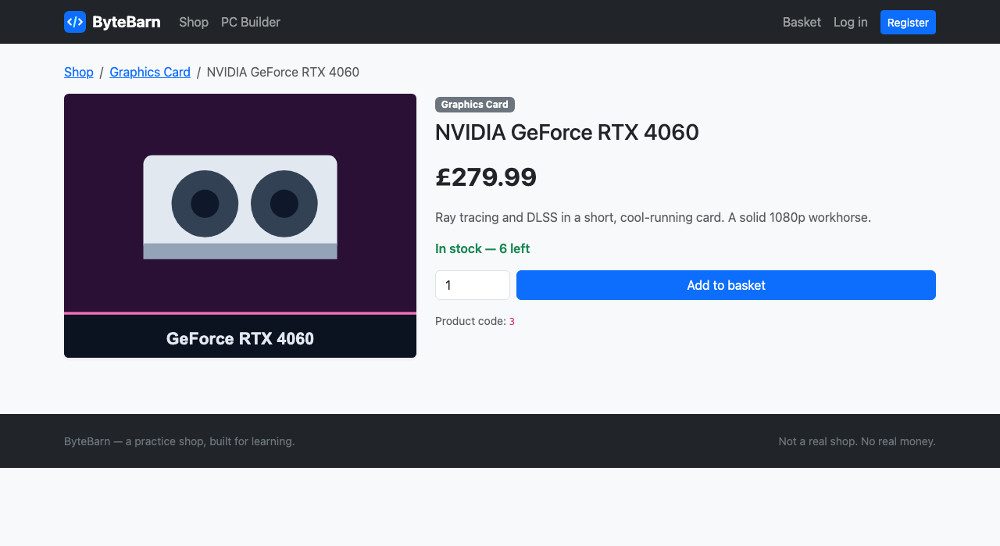

# 08 — The product page

**Mission:** give each product its own page at a nice URL, and fix the card links.
**Time:** about 30 minutes
**You will have when you finish:** every product clickable, and the site with no broken links.

---

## Before you start

- Guide 07 is finished
- Your shop page shows product cards

---

## Step 1 — Read `get_absolute_url` again

In Guide 05, we put this on the model:

```python
def get_absolute_url(self):
    return reverse("shop:product_detail", kwargs={"slug": self.slug})
```

That is the one thing this guide needs. The model knows how to find its own page,
so templates just say `{{ product.get_absolute_url }}` and never hard-code the
address.

This is worth pausing on. **Putting the rule in one place means changing it in one
place.** If the URLs change from `/shop/ryzen/` to `/products/ryzen/`, you edit
`urls.py` and this method — and every template updates itself.

---

## Step 2 — The URL with a variable in it

In `shop/urls.py`:

```python
from django.urls import path

from . import views

app_name = "shop"

urlpatterns = [
    path("", views.home, name="home"),
    path("shop/", views.product_list, name="product_list"),
    path("shop/<slug:slug>/", views.product_detail, name="product_detail"),
    #                          ↑ the < > part is a placeholder
]
```

The `<slug:slug>` in the middle means *"here goes whatever arrives in that
position"*. `<slug:...>` only matches lowercase letters, numbers, hyphens and
underscores — which is exactly what a slug is.

So `/shop/amd-ryzen-5-5600/` matches, and `/shop/Hello World/` does not.

> **Order matters again.** `shop/` comes before `shop/<slug:slug>/`. If you put
> the slug pattern first, `/shop/` would match it with an empty slug and the
> product list page would break.

---

## Step 3 — The view

In `shop/views.py`:

```python
def product_detail(request, slug):
    """One product on its own page."""
    product = get_object_or_404(Product, slug=slug)
    return render(request, "shop/product_detail.html", {"product": product})
```

Add the import:

```python
from django.shortcuts import get_object_or_404
```

### Why `get_object_or_404`?

`Product.objects.get(slug=slug)` raises `DoesNotExist` if nothing matches — you
would get a 500 error and a page full of traceback.

`get_object_or_404` returns **HTTP 404 — Not Found** instead, which is what
should happen when someone types a URL that does not exist.

> **Try it.** Go to <http://127.0.0.1:8000/shop/not-a-real-product/>. You get a
> tidy "Not Found" page. Now try `Product.objects.get()` instead and you get a
> wall of red traceback. Same problem, two very different experiences — one of
> them is for your users, the other is for you.

The `slug` parameter in the view matches the `<slug:slug>` in the URL. Same name,
that is how Django pairs them up.

---

## Step 4 — The template

Create `templates/shop/product_detail.html`:

```html



{{ product.name }} — ByteBarn


<nav aria-label="breadcrumb">
  <ol class="breadcrumb">
    <li class="breadcrumb-item"><a href="">Shop</a></li>
    <li class="breadcrumb-item">
      <a href="?category={{ product.category }}">
        {{ product.get_category_display }}
      </a>
    </li>
    <li class="breadcrumb-item active" aria-current="page">{{ product.name }}</li>
  </ol>
</nav>

<div class="row g-4">
  <div class="col-md-5">
    
  </div>

  <div class="col-md-7">
    <span class="badge text-bg-secondary mb-2">{{ product.get_category_display }}</span>
    <h1 class="h3">{{ product.name }}</h1>

    <p class="fs-2 fw-bold my-3">{{ currency }}{{ product.price }}</p>

    <p class="text-body-secondary">{{ product.description|linebreaksbr }}</p>

    
      <p class="text-success fw-semibold">In stock — {{ product.stock }} left</p>
    
      <p class="text-danger fw-semibold">Out of stock</p>
    

    <form action="#" method="post" class="d-flex gap-2">
      
      <input type="number" name="qty" value="1" min="1" class="form-control" style="max-width: 6rem">
      <button class="btn btn-primary flex-grow-1" type="submit">Add to basket</button>
    </form>
  </div>
</div>

```

### New things

**`{{ product.name }} — ByteBarn`** — the title
is now different on every page, and we did it without any extra view code.

**`|linebreaksbr`** — another filter. The description is stored as one long line
with `\n` in it; this filter turns those into `<br>` tags so the text lines up
the way you typed it.

**``** — in a template, `>` works inside ``.
Templates can do logic, but keep it small. If a page needs real decision-making,
put it in the view.

**``** — every form that sends data **must** include this, or
Django refuses. (More in Guide 11.)

---

## Step 5 — Put the card links back

Open `templates/shop/_product_card.html`. If you swapped them for `#` in Guide 07,
put them back:

```html
<a href="{{ product.get_absolute_url }}">
```

There are two of them — one around the image, one around the name. Both should
now work.

**Checkpoint.** Click a product name on the shop page. You land on
`/shop/amd-ryzen-5-5600/` and see the full product.



---

## Step 6 — Make the button honest

The Add to basket button does nothing yet. That is fine, but a button that lies
is worse than no button. Change it to something that does what it says:

```html
<a href="" class="btn btn-outline-secondary btn-sm w-100 mt-auto">
  Adding to the basket comes in Guide 11
</a>
```

Or leave the real `<button>` in and just accept that it does nothing until Guide
11. Your choice — but do it on purpose rather than by forgetting.

---

## Mission complete

- [ ] `path("shop/<slug:slug>/", views.product_detail, name="product_detail")` is in `shop/urls.py`
- [ ] The slug pattern comes after the plain `/shop/` pattern
- [ ] `product_detail` uses `get_object_or_404`
- [ ] `/shop/amd-ryzen-5-5600/` works, and `/shop/nonsense/` gives a 404
- [ ] Every card link works
- [ ] The page title includes the product name

**Commit:** `git commit -m "Guide 08: product detail page"`

---

## If something goes wrong

**`NoReverseMatch: Reverse for 'shop:product_detail'`**
The URL is not in `shop/urls.py`, or the name has a typo. Remember the namespace:
`shop:product_detail`, not `product_detail`.

**The page 404s for a product that definitely exists**
Check the `image` field and the slug. Go to `/admin/shop/product/` and copy the
slug from the URL when you hover the name.

**`Product matching query does not exist`**
You used `.get()` instead of `get_object_or_404`. That error is what
`get_object_or_404` exists to prevent.

**The Shop page now 404s**
You put `path("shop/<slug:slug>/", ...)` **above** `path("shop/", ...)`. Swap
them.

**The image is a huge stretched square**
That is the `card-img-top` class from the card. On the detail page we use
`img-fluid` and `w-100` instead, which scale without distorting.

**`TemplateSyntaxError`**
Check every `` has `` and every `` has
``.

---

Next: [09 — Register and log in](09-register-and-login.md)