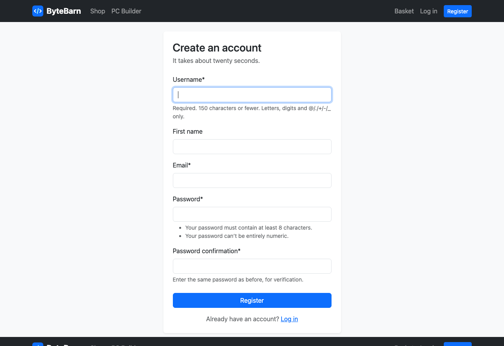
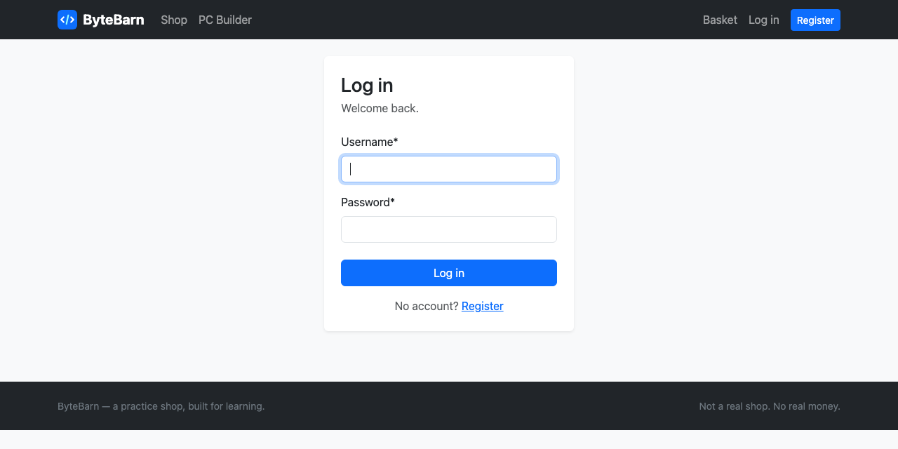

# 09 — Register and log in

**Mission:** let customers create an account and sign in, with forms that look good because of crispy-forms.
**Time:** about 45 minutes
**You will have when you finish:** working Register and Log in pages, and a navbar that changes depending on who you are.

---

## Before you start

- Guide 08 is finished and committed
- You have logged in to `/admin/` at least once

---

## Step 1 — Turn on Django's built-in account URLs

Django ships working login, logout and change-password pages. You get them for
free — you only have to say where they live.

In `config/urls.py`:

```python
from django.contrib import admin
from django.urls import include, path

urlpatterns = [
    path("admin/", admin.site.urls),

    # Django's own login / logout / change-password pages.
    # That gives us /accounts/login/, /accounts/logout/ and so on, for free.
    path("accounts/", include("django.contrib.auth.urls")),

    # Everything else belongs to the shop app, so / goes straight there.
    path("", include("shop.urls")),
]
```

**Checkpoint.** Go to <http://127.0.0.1:8000/accounts/login/>. Django shows a
very plain login form. It works — try logging in as your superuser — but it looks
like it came from 2005. We will style it in a moment.

> **What you just got.** Six pages, no Python written: `/accounts/login/`,
> `/accounts/logout/`, `/accounts/password_change/`,
> `/accounts/password_change/done/`, `/accounts/password_reset/` and
> `/accounts/password_reset/done/`. They all need templates, which we will add.

---

## Step 2 — Write the register form

Django already has a good sign-up form called `UserCreationForm`. We are not
replacing it — we are adding an email field.

Create `accounts/forms.py`:

```python
"""Forms for the accounts app.

Django already ships a UserCreationForm. We are not replacing it, we are just
adding an email field to it.
"""

from django import forms
from django.contrib.auth.forms import UserCreationForm
from django.contrib.auth.models import User


class RegisterForm(UserCreationForm):
    """The sign-up form: username, first name, email, password, confirm password."""

    email = forms.EmailField(required=True)

    class Meta(UserCreationForm.Meta):
        model = User
        fields = ("username", "first_name", "email")

    def save(self, commit=True):
        # UserCreationForm already knows how to hash and save the password.
        # We just copy our extra fields across.
        user = super().save(commit=False)
        user.email = self.cleaned_data["email"]
        user.first_name = self.cleaned_data.get("first_name", "")

        if commit:
            user.save()

        return user
```

### What is going on here

- **`class RegisterForm(UserCreationForm)`** — inheritance. We get password
  hashing, the "passwords must match" check, and validation for free, then add
  two fields.
- **`class Meta(UserCreationForm.Meta)`** — inherited again. We are only changing
  *which* fields from the `User` model appear.
- **`super().save()`** — "run the parent's version first, then add my bits".
  Without `super()`, the password would not be saved correctly.
- **`commit=False`** — "build the user object but do not write to the database
  yet". We set our extra fields, then save.

> **Passwords are never stored as typed.** Django hashes them — scrambles them
> into something like `pbkdf2_sha256$260000$abc...`. If the database is ever
> stolen, the passwords are useless. This is one of the things Django does for
  free that you would otherwise forget.

---

## Step 3 — The register view

In `accounts/views.py`, replace the file with:

```python
from django.contrib import messages
from django.contrib.auth import login
from django.shortcuts import redirect, render

from .forms import RegisterForm


def register(request):
    """Create a customer account."""
    if request.user.is_authenticated:
        return redirect("accounts:dashboard")

    form = RegisterForm(request.POST or None)

    if request.method == "POST" and form.is_valid():
        user = form.save()
        # Log them straight in, so they do not have to type the password again.
        login(request, user)
        messages.success(request, f"Welcome to the shop, {user.first_name or user.username}!")
        return redirect("accounts:dashboard")

    return render(request, "accounts/register.html", {"form": form})
```

Read `RegisterForm(request.POST or None)` carefully:

| Situation | `request.POST or None` gives | Result |
|-----------|-----------------------------|--------|
| First visit (GET) | `None` | an empty form |
| Submitting (POST) | the submitted data | a filled-in form to check |

So one line handles both "show the form" and "check the form". One of the tidiest
patterns in Django.

`form.is_valid()` runs every validation rule. If it passes, `form.save()` creates
the user.

---

## Step 4 — The URLs

Create `accounts/urls.py`:

```python
from django.urls import path

from . import views

app_name = "accounts"

urlpatterns = [
    path("register/", views.register, name="register"),
]
```

And in `config/urls.py`, **above** `include("django.contrib.auth.urls")`:

```python
    # Our own accounts pages (register, dashboard, orders).
    path("accounts/", include("accounts.urls")),
```

> Both lines start with `accounts/`. That is fine — Django checks them in order
> and the URLs do not clash (`accounts/register/` vs `accounts/login/`). Keep
> yours first so it is easy to find later.

---

## Step 5 — The register template, with crispy

Create `templates/accounts/register.html`:

```html



Register — ByteBarn


<div class="row justify-content-center">
  <div class="col-md-7 col-lg-5">
    <div class="card border-0 shadow-sm">
      <div class="card-body p-4">
        <h1 class="h3 mb-1">Create an account</h1>
        <p class="text-body-secondary mb-4">It takes about twenty seconds.</p>

        <!-- {{ form|crispy }} turns the whole Django form into Bootstrap HTML -->
        <form method="post" novalidate>
          
          {{ form|crispy }}
          <button type="submit" class="btn btn-primary w-100 mt-2">Register</button>
        </form>

        <p class="text-center text-body-secondary mt-3 mb-0">
          Already have an account? <a href="">Log in</a>
        </p>
      </div>
    </div>
  </div>
</div>

```

### Two lines doing all the work

**``** — loads the crispy tag library, so we can use
its tags.

**`{{ form|crispy }}`** — this is the whole trick. That one filter turns a plain
Django form into Bootstrap 5 HTML: labels, inputs, help text, error messages, all
styled correctly.

Without it you would write out every `<label>` and `<input>` by hand, plus all
the Bootstrap classes, plus all the markup for showing errors. Crispy does it in
one line and keeps it correct.



> **`novalidate`** on the form turns off the browser's own error bubbles. We let
> Django do the validation so that the messages look the same everywhere.

---

## Step 6 — The login page, also with crispy

Django's login page is now working but ugly. Give it a template and Django will
use yours instead.

Create `templates/registration/login.html`:

```html



Log in — ByteBarn


<div class="row justify-content-center">
  <div class="col-md-6 col-lg-4">
    <div class="card border-0 shadow-sm">
      <div class="card-body p-4">
        <h1 class="h3 mb-1">Log in</h1>
        <p class="text-body-secondary mb-4">Welcome back.</p>

        <form method="post" novalidate>
          
          {{ form|crispy }}
          <button type="submit" class="btn btn-primary w-100 mt-2">Log in</button>
        </form>

        <p class="text-center text-body-secondary mt-3 mb-0">
          No account? <a href="">Register</a>
        </p>
      </div>
    </div>
  </div>
</div>

```



---

## Step 7 — "You have been logged out"

After logging out, Django needs a page to show. It looks for
`registration/logged_out.html`:

```html


Logged out — ByteBarn


<div class="row justify-content-center">
  <div class="col-md-6">
    <div class="card border-0 shadow-sm">
      <div class="card-body p-5 text-center">
        <h1 class="h3 mb-2">You are logged out</h1>
        <p class="text-body-secondary">Your basket is still saved.</p>
        <a href="" class="btn btn-primary">Log in again</a>
      </div>
    </div>
  </div>
</div>

```

---

## Step 8 — Make the navbar react to who you are

Right now it always shows *Log in* and *Register*. Replace the second `<ul>` in
`base.html` — the one with those two links — with:

```html
        <ul class="navbar-nav align-items-lg-center">
          <li class="nav-item">
            <a class="nav-link" href="">Basket</a>
          </li>

          
            <li class="nav-item">
              <a class="nav-link" href="">Dashboard</a>
            </li>
            <li class="nav-item dropdown">
              <a class="nav-link dropdown-toggle" href="#" role="button"
                 data-bs-toggle="dropdown">Hi, {{ user.first_name|default:user.username }}</a>
              <ul class="dropdown-menu dropdown-menu-end">
                <li><a class="dropdown-item" href="">Dashboard</a></li>
                <li><a class="dropdown-item" href="">My orders</a></li>
                <li><a class="dropdown-item" href="">Change password</a></li>
                <li>
                  <hr class="dropdown-divider">
                </li>
                <li>
                  <!-- Logging out must be a POST in Django 5, so it needs a form -->
                  <form action="" method="post" class="px-3">
                    
                    <button type="submit" class="btn btn-sm btn-outline-danger">Log out</button>
                  </form>
                </li>
              </ul>
            </li>
          
            <li class="nav-item">
              <a class="nav-link" href="">Log in</a>
            </li>
            <li class="nav-item ms-lg-2">
              <a class="btn btn-primary btn-sm mt-1 mt-lg-0" href="">Register</a>
            </li>
          
        </ul>
```

### Why this is clever

- `user` is available in every template, automatically. You did not pass it in —
  `django.contrib.auth.context_processors.auth` puts it there.
- `user.is_authenticated` is `True` when logged in, `False` otherwise. One ``
  controls the whole navbar.
- `{{ user.first_name|default:user.username }}` — if they gave a first name use
  that, otherwise use their username.
- The dropdown needs `data-bs-toggle="dropdown"` so Bootstrap's JavaScript opens it.
- **The Log out button is inside a `<form>`.** Since Django 5, logging out has to
  be a POST request — a plain link cannot do it. Putting a button in a form is how.

**Checkpoint.** Log out, and the navbar shows *Log in / Register* again. Log in,
and it shows *Dashboard* and *Hi, sam*.

> **Dashboard, My orders and Basket links will 404** until Guides 10, 12 and 11.
> That is expected. Keep going.

---

## Mission complete

- [ ] `config/urls.py` includes `django.contrib.auth.urls`
- [ ] `accounts/forms.py` has a `RegisterForm` with an email field
- [ ] `accounts/views.py` has a `register` view that logs the user in
- [ ] `accounts/urls.py` routes `/accounts/register/`
- [ ] The register page renders with `{{ form|crispy }}` and looks like Bootstrap
- [ ] You can register a new account and are logged in afterwards
- [ ] Login and logout work, and the navbar changes
- [ ] Logging out is a form with a CSRF token

**Commit:** `git commit -m "Guide 09: register and login"`

---

## If something goes wrong

**`CommandError: field name 'email' is not valid for model 'User'`**
You put `email` inside `fields` instead of declaring it as its own field. It is
both: declare `email = forms.EmailField()` on the class, and list it in `Meta.fields`.

**The register page says `NoReverseMatch` for the dashboard**
The `redirect("accounts:dashboard")` needs a URL named `dashboard`. Temporarily
use `redirect("shop:home")` and change it in Guide 10.

**The form looks completely unstyled**
You forgot ``, or `crispy_forms` and `crispy_bootstrap5`
are not in `INSTALLED_APPS`.

**`DisallowedHost` / `Bad Request (400)` when submitting the form**
Usually a missing ``.

**Registering says the username is taken**
Each username must be unique. Add a number, or log in as that user instead.

**Password rejected: "This password is too similar to the username"**
Either use a different password, or relax `AUTH_PASSWORD_VALIDATORS` in
`settings.py` as Guide 02 showed.

**Logging out gives a 405 error**
Your logout link is a plain `<a>`. It has to be a `<form method="post">` with a
``.

**`TemplateDoesNotExist: registration/login.html`**
The file must be at `templates/registration/login.html` — that exact folder name,
not `templates/accounts/`.

---

Next: [10 — The dashboard](10-dashboard.md)