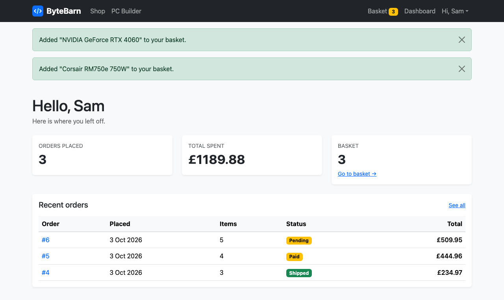

# 10 — The dashboard

**Mission:** build each customer's own home page, and make sure only logged-in users can see it.
**Time:** about 30 minutes
**You will have when you finish:** a private dashboard that knows whose it is.

---

## Before you start

- Guide 09 is finished — you can register and log in
- Your navbar has a Dashboard link

---

## Step 1 — The view

In `accounts/views.py`, add:

```python
from django.contrib.auth.decorators import login_required


@login_required
def dashboard(request):
    """The customer's own home page."""
    orders = request.user.orders.all()

    context = {
        "total_orders": orders.count(),
        "total_spent": sum(order.total for order in orders),
        "recent_orders": orders[:5],
    }
    return render(request, "accounts/dashboard.html", context)
```

```python
urlpatterns = [
    path("register/", views.register, name="register"),
    path("dashboard/", views.dashboard, name="dashboard"),
]
```

Add that line to `accounts/urls.py`.

---

## Step 2 — What `@login_required` actually does

This decorator is the most important thing in the guide, so look at what it is
really doing:

```python
@login_required
def dashboard(request):
    ...
```

**Unrolled, it is this:**

```python
def dashboard(request):
    if not request.user.is_authenticated:
        return redirect(settings.LOGIN_URL + "?next=" + request.path)
    ...
```

If you are not logged in, it throws you to the login page and remembers where you
were going. Log in, and it sends you straight back to the dashboard instead of
the home page.

> **The `?next=` part** is why, after logging in, you land where you wanted to
> go. Our login link on the basket page uses it too — see Guide 11.

> **`LOGIN_URL = "login"` in settings** — the name we redirect to. Not a path
> like `/accounts/login/`; a URL *name*. Change it in settings, in one place.

**Checkpoint.** Log out, then go straight to
<http://127.0.0.1:8000/accounts/dashboard/>. You are bounced to the login page.
Log in. You arrive at your dashboard.

This is **access control**. Without the decorator, anyone who typed the address
could see anyone's dashboard. It is one line of Python and it is the difference
between a toy and something you can trust.

---

## Step 3 — `request.user.orders`

Go back to Guide 05's `Product` model. We have not written the `Order` model yet —
it arrives in Guide 12. For now, create a stand-in so this guide works:

In `shop/models.py`, add at the bottom:

```python
class Order(models.Model):
    """A single purchase made by a customer.

    The full version with OrderItem arrives in Guide 12. This version is enough
    for the dashboard.
    """

    STATUS_CHOICES = [
        ("pending", "Pending"),
        ("paid", "Paid"),
        ("shipped", "Shipped"),
        ("cancelled", "Cancelled"),
    ]

    customer = models.ForeignKey(
        settings.AUTH_USER_MODEL, on_delete=models.CASCADE, related_name="orders"
    )
    total = models.DecimalField(max_digits=10, decimal_places=2, default=0)
    status = models.CharField(max_length=20, choices=STATUS_CHOICES, default="pending")
    created_at = models.DateTimeField(auto_now_add=True)

    class Meta:
        ordering = ["-created_at"]

    def __str__(self):
        return f"Order #{self.pk} - {self.customer.username}"

    @property
    def item_count(self):
        return 0
```

And add the import at the top of `models.py`:

```python
from django.conf import settings
```

Then make and apply the migration:

```bat
python manage.py makemigrations shop
python manage.py migrate
```

Now look again at that line:

```python
customer = models.ForeignKey(
    settings.AUTH_USER_MODEL, on_delete=models.CASCADE, related_name="orders"
)
```

`related_name="orders"` means: *"from any user object, `user.orders` gives me
their orders"*. So `request.user.orders.all()` is this customer's orders and
nobody else's.

> **That is the whole security model of the dashboard.** There is no filter to
> forget, no chance of accidentally showing everyone. The relationship does it.
> Always ask "where does this list come from?" before you build a page around it.

---

## Step 4 — Give yourself some order data

Go into `python manage.py shell`:

```python
>>> from shop.models import Order
>>> me = User.objects.get(username="your-username")
>>> Order.objects.create(customer=me, total=234.97, status="shipped")
<Order: Order #1 - your-username>
>>> Order.objects.create(customer=me, total=444.96, status="paid")
<Order: Order #2 - your-username>
```

Now log in as that user and open the dashboard.

---

## Step 5 — The template

Create `templates/accounts/dashboard.html`:

```html


Your dashboard — ByteBarn


<h1 class="page-title">Hello, {{ user.first_name|default:user.username }}</h1>
<p class="text-body-secondary mb-4">Here is where you left off.</p>

<div class="row row-cols-1 row-cols-sm-3 g-4 mb-4">
  <div class="col">
    <div class="card border-0 shadow-sm">
      <div class="card-body">
        <div class="text-body-secondary text-uppercase small">Orders placed</div>
        <div class="fs-2 fw-bold">{{ total_orders }}</div>
      </div>
    </div>
  </div>
  <div class="col">
    <div class="card border-0 shadow-sm">
      <div class="card-body">
        <div class="text-body-secondary text-uppercase small">Total spent</div>
        <div class="fs-2 fw-bold">{{ currency }}{{ total_spent }}</div>
      </div>
    </div>
  </div>
  <div class="col">
    <div class="card border-0 shadow-sm">
      <div class="card-body">
        <div class="text-body-secondary text-uppercase small">Basket</div>
        <div class="fs-2 fw-bold">{{ cart_count }}</div>
        <a href="" class="small">Go to basket →</a>
      </div>
    </div>
  </div>
</div>

<div class="card border-0 shadow-sm">
  <div class="card-body">
    <div class="d-flex justify-content-between align-items-center mb-3">
      <h2 class="h5 mb-0">Recent orders</h2>
      <a href="" class="small">See all</a>
    </div>

    
      <div class="table-responsive">
        <table class="table align-middle mb-0">
          <thead class="table-light">
            <tr>
              <th>Order</th><th>Placed</th><th>Items</th><th>Status</th>
              <th class="text-end">Total</th>
            </tr>
          </thead>
          <tbody>
            
              <tr>
                <td class="table-order-id">
                  <a href="#" class="text-decoration-none">#{{ order.pk }}</a>
                </td>
                <td>{{ order.created_at|date:"j M Y" }}</td>
                <td>{{ order.item_count }}</td>
                <td>
                  <span class="badge text-bg-warning">{{ order.get_status_display }}</span>
                </td>
                <td class="text-end fw-semibold">{{ currency }}{{ order.total }}</td>
              </tr>
            
          </tbody>
        </table>
      </div>
    
      <div class="empty-state p-5 text-center">
        <p class="mb-2 text-body-secondary">You have not ordered anything yet.</p>
        <a href="" class="btn btn-primary btn-sm">Find your first part</a>
      </div>
    
  </div>
</div>

```

### New things

**`{{ order.created_at|date:"j M Y" }}`** — another filter, and a very useful
one. Without it you get `2026-10-03 15:22:41.284913+01:00`. With it you get
`3 Oct 2026`. The characters are [Django date format
codes](https://docs.djangoproject.com/en/5.1/ref/templates/builtins/#date):
`j` = day without a leading zero, `M` = short month name, `Y` = four-digit year.

**``** — a number is falsy if it is zero, so this means
"if they have ordered something, show the See all link".

**``** — an empty queryset is falsy too, so this handles the
"new customer, no orders" case without any extra work.

**``** — `orders[:5]` in the view sliced the
QuerySet for us. No `LIMIT` written by hand.

**The order number link points at `#`** — it becomes a real link in Guide 12.



---

## Step 6 — Point the links that will not work yet

Two links in the navbar 404 right now:

| Link | Needs | Fixed in |
|------|-------|----------|
| My orders | `order_history` view | Guide 12 |
| Basket | `cart` view | Guide 11 |

Carry on — or comment them out if you want a clean site between lessons. They are
not bugs.

---

## Mission complete

- [ ] `dashboard` is decorated with `@login_required`
- [ ] Visiting `/accounts/dashboard/` while logged out redirects to login
- [ ] Logging in takes you back to the dashboard you wanted
- [ ] `Order` model exists with `related_name="orders"`
- [ ] The page shows orders placed, total spent and basket count
- [ ] A customer with no orders gets a friendly empty message
- [ ] Dates are formatted as `3 Oct 2026`, not a timestamp

**Commit:** `git commit -m "Guide 10: customer dashboard"`

---

## If something goes wrong

**`AttributeError: 'User' object has no attribute 'orders'`**
The `Order` model is missing, or `related_name` is not `"orders"`, or you have not
run `makemigrations` and `migrate` since adding it.

**The dashboard 404s for every customer**
It also needs `path("dashboard/", views.dashboard, name="dashboard")` in
`accounts/urls.py`.

**It does not redirect when logged out**
You forgot `@login_required`, or forgot to import it.

**It redirects in a loop**
`LOGIN_REDIRECT_URL` points at a page that also needs a login. Make sure it
points at the dashboard or the home page, not the login page.

**Total spent is always 0**
`total` is a `DecimalField`, so the raw value looks like `Decimal('234.97')`.
`{{ total_spent }}` with `` absent from the template will not
format it — make sure `{{ currency }}{{ total_spent }}` and that the view sums
`order.total`, not `order.id`.

**My orders 404s**
Expected until Guide 12.

---

Next: [11 — The basket](11-the-basket.md)