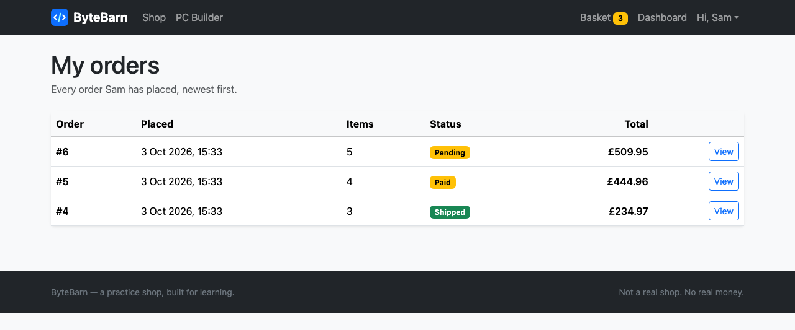
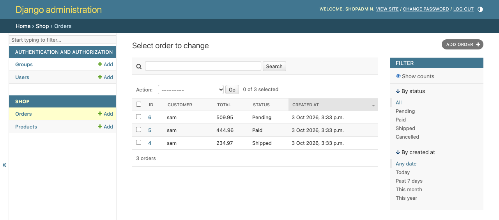
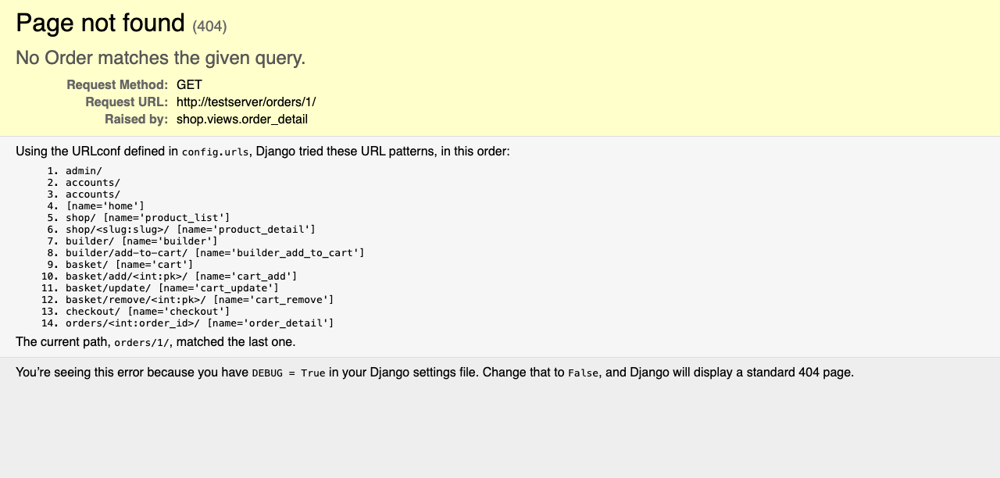

# 12 — Checkout and purchase history

**Mission:** turn a basket into a real order in the database, then show each customer their own order history and receipts.
**Time:** about 50 minutes
**You will have when you finish:** the final feature. Orders are saved, stock goes down, and nobody can see anybody else's orders.

---

## Before you start

- Guide 11 is finished and committed
- You can put things in a basket

---

## Step 1 — Add the OrderItem model

An `Order` on its own does not say *what* was bought. It needs lines.

In `shop/models.py`, replace the simplified `Order` from Guide 10 with the full
version, and add `OrderItem` after it:

```python
class Order(models.Model):
    """A single purchase made by a customer."""

    STATUS_CHOICES = [
        ("pending", "Pending"),
        ("paid", "Paid"),
        ("shipped", "Shipped"),
        ("cancelled", "Cancelled"),
    ]

    customer = models.ForeignKey(
        settings.AUTH_USER_MODEL, on_delete=models.CASCADE, related_name="orders"
    )
    total = models.DecimalField(max_digits=10, decimal_places=2, default=0)
    status = models.CharField(max_length=20, choices=STATUS_CHOICES, default="pending")
    created_at = models.DateTimeField(auto_now_add=True)

    class Meta:
        ordering = ["-created_at"]

    def __str__(self):
        return f"Order #{self.pk} - {self.customer.username}"

    @property
    def item_count(self):
        """How many physical things were bought (not how many line items)."""
        return sum(item.quantity for item in self.items.all())


class OrderItem(models.Model):
    """One line on an order.

    We copy the price onto the order line on purpose. If a product price changes
    tomorrow, yesterday's receipt must still show what the customer actually paid.
    """

    order = models.ForeignKey(Order, on_delete=models.CASCADE, related_name="items")
    product = models.ForeignKey(Product, on_delete=models.CASCADE)
    quantity = models.PositiveIntegerField(default=1)
    price = models.DecimalField(max_digits=8, decimal_places=2)

    def __str__(self):
        return f"{self.quantity} x {self.product.name}"

    @property
    def line_total(self):
        return self.price * self.quantity
```

```bat
python manage.py makemigrations shop
python manage.py migrate
```

### Why copy the price onto the order line?

This is the most important design decision in the guide, so think about it.

Say you buy a £130 CPU. Next week the shop puts it up to £180. If the receipt
just said *"the current price of this product"*, your old order would silently
change to £180. Nobody would trust the receipts, and you would never be able to
answer *"what did I pay in March?"*

So `OrderItem` stores its own `price`, frozen at the moment of purchase. The
receipt can never change.

> This is a **denormalised copy**. Normally you avoid storing the same thing
> twice, because copies drift out of step. But a receipt is a record of a past
> event, not a live view of current prices. Copies are correct here.

### About `@property`

`item_count` and `line_total` are calculations, not stored data — they are
computed on demand from the other fields. `@property` makes them look like plain
attributes (`order.item_count`) while running Python underneath.

### About `related_name="items"`

`order.items.all()` gives the lines on an order. The other direction — every
`OrderItem` pointing at one `Order` — is the database's job to enforce.

---

## Step 2 — The checkout view

In `shop/views.py`:

```python
from django.db import transaction


@login_required
@require_POST
def checkout(request):
    """Turn the basket into a real order in the database."""
    items, total = cart.cart_details(request)

    if not items:
        messages.warning(request, "Your basket is empty.")
        return redirect("shop:cart")

    # transaction.atomic means: if anything below goes wrong, nothing is saved.
    # Either we get a whole order or we get nothing at all.
    with transaction.atomic():
        order = Order.objects.create(
            customer=request.user, total=total, status="paid"
        )

        for item in items:
            product = item["product"]
            quantity = item["quantity"]

            OrderItem.objects.create(
                order=order,
                product=product,
                quantity=quantity,
                price=product.price,  # copy the price, so it never changes later
            )

            # Take the stock away.
            # Mission: if two people buy the last one at the same moment, this
            # can go negative. Look up F() expressions and fix it.
            product.stock -= quantity
            product.save(update_fields=["stock"])

    cart.clear_cart(request)
    messages.success(request, f"Order #{order.pk} placed. Thank you!")
    return redirect("shop:order_detail", order_id=order.pk)
```

Add the imports:

```python
from django.contrib.auth.decorators import login_required
from django.db import transaction
from django.views.decorators.http import require_POST

from .models import Order, OrderItem
```

### Two decorators, and why both

```python
@login_required
@require_POST
def checkout(request):
```

Read decorators from the bottom up: `@require_POST` wraps the function, then
`@login_required` wraps that. So the request is checked for the POST method
first, then for a logged-in user.

**Both are essential.** Without `@login_required`, anyone could post to
`/checkout/` and create orders in somebody else's name. Without
`@require_POST`, a link could trigger a purchase.

### What `transaction.atomic` does

Checkout writes to two tables — `shop_order` and `shop_orderitem` — and updates
a third. If something fails halfway through (the server stops, a value is too
long), you could end up with an order with no items, or stock taken away with no
order to explain it.

`with transaction.atomic():` means *all of it or none of it*. Indent everything
inside the `with` and you get that guarantee for free.

> **The order matters.** Decorators go on top in the order above, and URLs go
> most-specific first. Python reads decorators from the bottom up; Django reads
> URLs from the top down. Both catch people.

---

## Step 3 — The receipt view

```python
@login_required
def order_detail(request, order_id):
    """A receipt for one order.

    Notice `customer=request.user` in the lookup. Without it, a customer could
    type another order number into the address bar and read someone else's
    receipt.
    """
    order = get_object_or_404(Order, pk=order_id, customer=request.user)
    return render(request, "shop/order_detail.html", {"order": order})
```

### Look closely at that lookup

Compare the two:

```python
Order.objects.get(pk=order_id)                          # ❌ dangerous
Order.objects.get(pk=order_id, customer=request.user)  # ✅ safe
```

The first finds order 7 no matter who asks. The second only finds order 7 **if
the person asking is the one who placed it**.

This is one of the most common real security bugs in web applications, and it is
usually just a missing filter. Whenever you build a page that shows one
customer's data, filter by the logged-in user *in the query*, not in the
template.

---

## Step 4 — The URLs

In `shop/urls.py`:

```python
urlpatterns = [
    path("", views.home, name="home"),
    path("shop/", views.product_list, name="product_list"),
    path("shop/<slug:slug>/", views.product_detail, name="product_detail"),
    path("builder/", views.builder, name="builder"),
    path("basket/", views.cart_view, name="cart"),
    path("basket/add/<int:pk>/", views.cart_add, name="cart_add"),
    path("basket/update/", views.cart_update, name="cart_update"),
    path("basket/remove/<int:pk>/", views.cart_remove, name="cart_remove"),
    path("checkout/", views.checkout, name="checkout"),
    path("orders/<int:order_id>/", views.order_detail, name="order_detail"),
]
```

---

## Step 5 — The receipt template

Create `templates/shop/order_detail.html`:

```html



Order #{{ order.pk }} — ByteBarn


<nav aria-label="breadcrumb">
  <ol class="breadcrumb">
    <li class="breadcrumb-item"><a href="">My orders</a></li>
    <li class="breadcrumb-item active" aria-current="page">Order #{{ order.pk }}</li>
  </ol>
</nav>

<div class="d-flex flex-wrap justify-content-between align-items-center gap-2 mb-4">
  <h1 class="page-title mb-0">Order #{{ order.pk }}</h1>
  <span class="badge fs-6
        text-bg-danger
        text-bg-success
        text-bg-warning">
    {{ order.get_status_display }}
  </span>
</div>

<div class="row g-4">
  <div class="col-lg-8">
    <div class="card border-0 shadow-sm">
      <div class="table-responsive">
        <table class="table align-middle mb-0">
          <thead class="table-light">
            <tr>
              <th>Product</th>
              <th class="text-end">Price paid</th>
              <th class="text-end">Qty</th>
              <th class="text-end">Line total</th>
            </tr>
          </thead>
          <tbody>
            
              <tr>
                <td>
                  <a href="{{ item.product.get_absolute_url }}" class="text-decoration-none text-body">
                    {{ item.product.name }}
                  </a>
                </td>
                <td class="text-end">{{ currency }}{{ item.price }}</td>
                <td class="text-end">{{ item.quantity }}</td>
                <td class="text-end fw-semibold">{{ currency }}{{ item.line_total }}</td>
              </tr>
            
          </tbody>
          <tfoot class="table-light">
            <tr>
              <th colspan="3" class="text-end">Total</th>
              <th class="text-end fs-5">{{ currency }}{{ order.total }}</th>
            </tr>
          </tfoot>
        </table>
      </div>
    </div>
  </div>

  <div class="col-lg-4">
    <div class="card border-0 shadow-sm">
      <div class="card-body">
        <h2 class="h5">Order details</h2>
        <p class="mb-1"><strong>Placed:</strong> {{ order.created_at|date:"j M Y, H:i" }}</p>
        <p class="mb-1"><strong>Customer:</strong> {{ order.customer.username }}</p>
        <p class="mb-3"><strong>Items:</strong> {{ order.item_count }}</p>
        <a href="" class="btn btn-outline-secondary w-100">
          Back to my orders
        </a>
      </div>
    </div>
  </div>
</div>

```

Note **`{{ item.price }}`**, not `{{ item.product.price }}`. The receipt shows
what was paid, not what the product costs today.

---

## Step 6 — Turn the basket button on

In `cart.html`, replace the dead *Place order* link:

```html
          
            <form action="" method="post" class="mt-3">
              
              <button type="submit" class="btn btn-success w-100">Place order</button>
            </form>
          
            <a href="?next={{ request.path }}"
               class="btn btn-success w-100 mt-3">Log in to check out</a>
            <p class="small text-body-secondary text-center mt-2 mb-0">
              No account yet? <a href="">Register</a>
            </p>
          
```

---

## Step 7 — The order history page

In `accounts/views.py`:

```python
@login_required
def order_history(request):
    """Every order this customer has ever placed, newest first."""
    orders = request.user.orders.all()
    return render(request, "accounts/order_history.html", {"orders": orders})
```

In `accounts/urls.py`:

```python
    path("orders/", views.order_history, name="order_history"),
```

Create `templates/accounts/order_history.html`:

```html


My orders — ByteBarn


<h1 class="page-title">My orders</h1>
<p class="text-body-secondary mb-4">
  Every order {{ user.first_name|default:user.username }} has placed, newest first.
</p>


  <div class="card border-0 shadow-sm">
    <div class="table-responsive">
      <table class="table align-middle mb-0">
        <thead class="table-light">
          <tr>
            <th>Order</th><th>Placed</th><th>Items</th><th>Status</th>
            <th class="text-end">Total</th><th></th>
          </tr>
        </thead>
        <tbody>
          
            <tr>
              <td class="table-order-id fw-semibold">#{{ order.pk }}</td>
              <td>{{ order.created_at|date:"j M Y, H:i" }}</td>
              <td>{{ order.item_count }}</td>
              <td>
                <span class="badge text-bg-danger
                      text-bg-success
                      text-bg-warning">
                  {{ order.get_status_display }}
                </span>
              </td>
              <td class="text-end fw-semibold">{{ currency }}{{ order.total }}</td>
              <td class="text-end">
                <a href="" class="btn btn-sm btn-outline-primary">
                  View
                </a>
              </td>
            </tr>
          
        </tbody>
      </table>
    </div>
  </div>

  <div class="empty-state p-5 text-center">
    <h2 class="h4">No orders yet</h2>
    <p class="text-body-secondary">When you buy something, it will show up here.</p>
    <a href="" class="btn btn-primary">Go to the shop</a>
  </div>


```



---

## Step 8 — Order management in the admin

So staff can see and update orders. In `shop/admin.py`:

```python
from django.contrib import admin

from .models import Order, OrderItem, Product


class OrderItemInline(admin.TabularInline):
    """Show the order lines inside the order page, so staff only edit one page."""

    model = OrderItem
    extra = 0


@admin.register(Product)
class ProductAdmin(admin.ModelAdmin):
    list_display = ["name", "category", "price", "stock", "featured"]
    list_filter = ["category", "featured"]
    search_fields = ["name", "description"]
    list_editable = ["price", "stock", "featured"]
    prepopulated_fields = {"slug": ("name",)}


@admin.register(Order)
class OrderAdmin(admin.ModelAdmin):
    list_display = ["id", "customer", "total", "status", "created_at"]
    list_filter = ["status", "created_at"]
    search_fields = ["customer__username", "customer__email"]
    inlines = [OrderItemInline]
```

`search_fields = ["customer__username"]` is another `__` lookup — this time
reaching *through* the relationship to search a related table.



---

## Step 9 — Test it properly

1. Log in, add three different products to the basket, check out.
2. You land on `/orders/5/` with a receipt and the basket is empty.
3. The navbar badge is gone.
4. `/accounts/dashboard/` shows orders placed: 1, and the order in the table.
5. **Change a product's price** in `/admin/`, then re-open the old receipt. It
   still shows the old price. That is `OrderItem.price` doing its job.
6. Put something in the basket and log out. Try to click *Place order* — you get
   the login page instead.
7. **The important one:** while logged in, try to visit another customer's order
   by typing its number into the address bar. You get **404, not found** — not
   their receipt.



---

## Mission complete

- [ ] `Order` and `OrderItem` exist and are migrated
- [ ] `OrderItem` stores its own copy of the price
- [ ] Checkout requires a login and a POST
- [ ] Checkout runs inside `transaction.atomic()`
- [ ] Stock is reduced when an order is placed
- [ ] The basket is emptied after checkout
- [ ] The receipt shows the price paid, not the current price
- [ ] `/accounts/orders/` lists only the logged-in customer's orders
- [ ] `/orders/<id>/` 404s for anyone but the owner
- [ ] Orders are manageable in `/admin/`

**Commit:** `git commit -m "Guide 12: checkout and purchase history"`

---

## If something goes wrong

**Checkout 405s**
The button is an `<a>`, not a `<form method="post">`. Every write needs a form.

**Checkout redirects to the basket with "Your basket is empty"**
You had nothing in it, or the session was cleared. Add something first.

**`The current path didn't match any URL` on the receipt**
The `builder` URL was added but the view does not exist yet — that line is from
Guide 13. Comment it out for now.

**Stock does not go down**
The loop is not running, or you forgot `product.save()` after changing `stock`.

**Stock goes negative**
Expected with this simple code — that is the mission note in `checkout`. See
[Guide 15](15-stretch-missions.md) for the fix.

**`RelatedObjectDoesNotExist` on the receipt**
`` needs `related_name="items"` on `OrderItem`.

**Orders appear for the wrong customer**
You used `Order.objects.all()` instead of `request.user.orders.all()`.

**I can see another customer's order**
You left `customer=request.user` out of `order_detail`'s lookup. That is a real
security bug, not a cosmetic one.

**`Order.total` is `Decimal('234.97')` on the page**
You printed `order.total` somewhere without the `{{ currency }}` prefix, or you
are displaying the raw object in a Python shell context.

---

Next: [13 — The PC cost calculator](13-pc-builder-calculator.md)