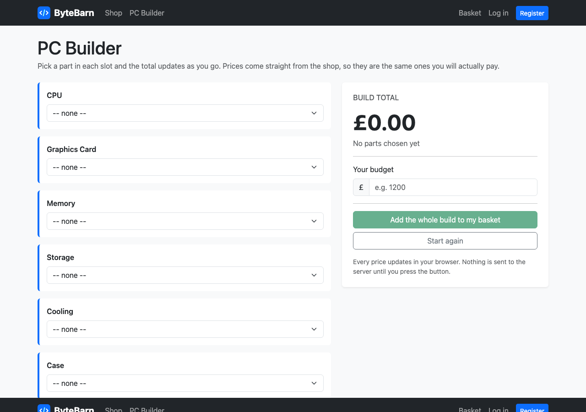
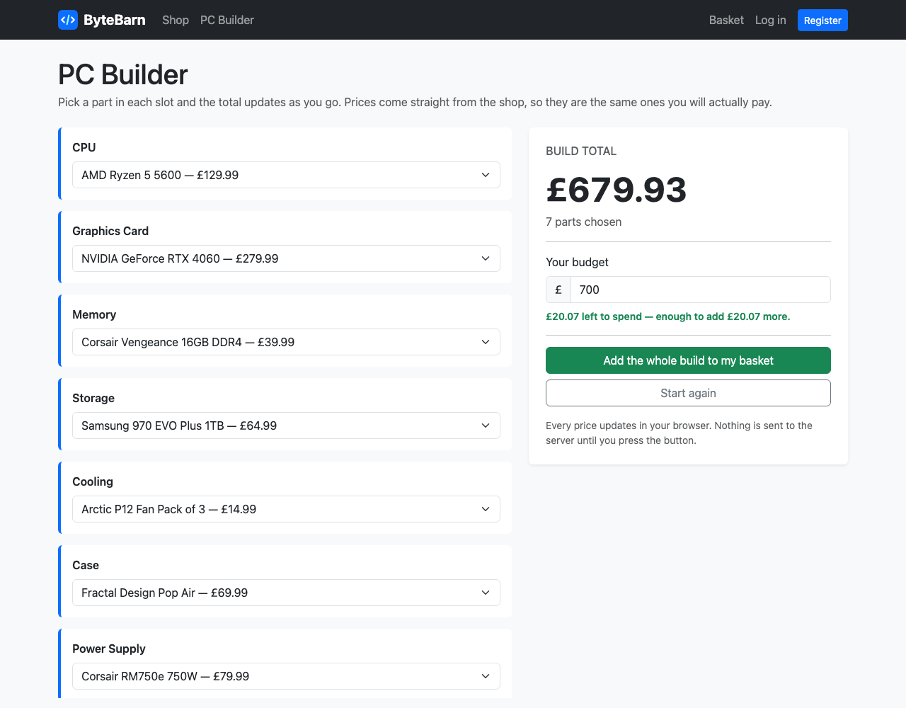

# 13 — The PC cost calculator

**Mission:** build the PC Builder — a page where you pick a part in each slot and the running total updates instantly, written in plain JavaScript.
**Time:** about 45 minutes
**You will have when you finish:** the last feature. Everything runs in the browser, with no external API and no internet needed.

---

## Before you start

- Guide 12 is finished and committed
- You have products in more than one category

---

## What we are building, and what we are not

| Yes | No |
|-----|-----|
| A dropdown of parts per slot | A live price feed from the internet |
| Prices from **your own database** | An API key, a rate limit, a downtime |
| Plain JavaScript | jQuery, React, Vue, a build step |
| Works with the Wi-Fi off | Needs the internet to load at all |

The calculator must never disagree with the shop. The surest way to guarantee
that is to take its numbers **from the same database the shop uses**.

---

## Step 1 — The view

In `shop/views.py`:

```python
# The slots in the PC Builder, in the order they appear on the page.
# Each value is a Product category.
BUILDER_SLOTS = ["cpu", "gpu", "ram", "storage", "cooling", "case", "psu"]


def builder(request):
    """The PC cost calculator.

    The prices come from the database, so the calculator can never disagree with
    the shop. All of the adding-up happens in JavaScript in the browser.
    """
    products = Product.objects.filter(stock__gt=0)

    # Turn the flat list of products into one group per builder slot, skipping
    # any category we have no products for.
    labels = dict(Product.CATEGORY_CHOICES)
    groups = [
        {
            "value": slot,
            "label": labels[slot],
            "parts": [p for p in products if p.category == slot],
        }
        for slot in BUILDER_SLOTS
    ]
    groups = [group for group in groups if group["parts"]]

    return render(request, "shop/builder.html", {"groups": groups})
```

In `shop/urls.py`:

```python
    path("builder/", views.builder, name="builder"),
```

**Checkpoint.** <http://127.0.0.1:8000/builder/> loads (it will complain about a
missing template for a moment — that is next).

> **Note the loops.** `for slot in BUILDER_SLOTS` then `for p in products` is
> O(n × m). With 12 products that is nothing. With 12,000 you would want one
> query. Fine now, and worth knowing about later.

---

## Step 2 — The template

Create `templates/shop/builder.html`:

```html



PC Builder — ByteBarn


<h1 class="page-title">PC Builder</h1>
<p class="text-body-secondary mb-4">
  Pick a part in each slot and the total updates as you go. Prices come straight
  from the shop, so they are the same ones you will actually pay.
</p>


  <form action="#" method="post" id="builder-form">
    

    <div class="row g-4">
      <!-- ============ Part slots ============ -->
      <div class="col-lg-7">
        
          <div class="part-row rounded p-3 mb-3">
            <label class="form-label fw-semibold" for="{{ group.value }}">
              {{ group.label }}
            </label>
            <select class="form-select" name="{{ group.value }}" id="{{ group.value }}"
                    data-part-select>
              <option value="">-- none --</option>
              
                <option value="{{ part.pk }}" data-price="{{ part.price }}">
                  {{ part.name }} — {{ currency }}{{ part.price }}
                </option>
              
            </select>
          </div>
        
      </div>

      <!-- ============ Running total ============ -->
      <div class="col-lg-5">
        <div class="card border-0 shadow-sm builder-total">
          <div class="card-body p-4">
            <h2 class="h6 text-uppercase text-body-secondary mb-3">Build total</h2>

            <div class="display-5 fw-bold mb-1" id="build-total">{{ currency }}0.00</div>
            <p class="text-body-secondary" id="build-count">No parts chosen yet</p>

            <hr>

            <label class="form-label" for="budget">Your budget</label>
            <div class="input-group mb-2">
              <span class="input-group-text">{{ currency }}</span>
              <input type="number" id="budget" class="form-control" placeholder="e.g. 1200" min="0" step="50">
            </div>
            <div id="budget-message" class="small text-body-secondary"></div>

            <hr>

            <div class="d-grid gap-2">
              <button type="submit" class="btn btn-success" id="add-build" disabled>
                Add the whole build to my basket
              </button>
              <button type="button" class="btn btn-outline-secondary" id="reset-build">
                Start again
              </button>
            </div>

            <p class="small text-body-secondary mt-3 mb-0">
              Every price updates in your browser. Nothing is sent to the server
              until you press the button.
            </p>
          </div>
        </div>
      </div>
    </div>
  </form>

  <div class="empty-state p-5 text-center text-body-secondary">
    <p class="mb-1">There are no parts in the shop yet.</p>
    <p class="mb-0">Load the sample data with <code>python manage.py seed_shop</code>.</p>
  </div>




  <!-- data-currency lets the JavaScript format money without hard-coding the symbol -->
  <script src="" data-currency="{{ currency }}"></script>

```

### The one clever bit: `data-price`

```html
<option value="3" data-price="279.99">NVIDIA GeForce RTX 4060 — £279.99</option>
```

`data-` attributes let us hang any value off an HTML element. The visible text is
for people; `data-price` is for the JavaScript.

> **Two prices, one source.** The text after the `—` is for the human. The
> `data-price` is what the calculator adds up. Both come from `product.price`, so
> they can never disagree. Do not type prices into the JavaScript as well — that
> is how calculators start lying.

### Why ``?

`` at the bottom of `base.html` is the last thing before
`</body>`. Scripts belong there, because the browser reads HTML top to bottom and
a script in the `<head>` cannot find elements that have not been parsed yet.

> **`` is a great test of a base template.** If your new page
> needs JavaScript and there is no scripts block, add one — once — and you never
> think about it again.

---

## Step 3 — The JavaScript

Create `static/js/builder.js`:

```javascript
/* ByteBarn PC Builder
   --------------------
   Adds up the parts as you choose them, and tells you how far over or under
   budget you are.

   Everything here runs in the browser. The server never sees these numbers. */

(function () {
  "use strict";

  // The currency symbol is set by Django in the <script> tag, so we do not have
  // to change it in two places if the shop starts using dollars.
  var script = document.currentScript;
  var CURRENCY = script ? script.dataset.currency || "£" : "£";

  var selects = document.querySelectorAll("[data-part-select]");
  var totalEl = document.getElementById("build-total");
  var countEl = document.getElementById("build-count");
  var budgetEl = document.getElementById("budget");
  var budgetMsgEl = document.getElementById("budget-message");
  var addButton = document.getElementById("add-build");
  var resetButton = document.getElementById("reset-build");

  if (!selects.length) {
    return; // No products in the shop yet, nothing to wire up.
  }

  // 1234.5 -> "£1,234.50"
  function money(amount) {
    return CURRENCY + amount.toFixed(2).replace(/\B(?=(\d{3})+(?!\d))/g, ",");
  }

  function chosenParts() {
    return Array.prototype.filter
      .call(selects, function (select) {
        return select.value !== "";
      })
      .map(function (select) {
        var option = select.options[select.selectedIndex];
        return {
          select: select,
          price: parseFloat(option.dataset.price) || 0
        };
      });
  }

  function recalculate() {
    var parts = chosenParts();

    var total = parts.reduce(function (running, part) {
      return running + part.price;
    }, 0);

    // --- the big number ---
    totalEl.textContent = money(total);

    // --- how many slots are filled ---
    if (parts.length === 0) {
      countEl.textContent = "No parts chosen yet";
    } else if (parts.length === 1) {
      countEl.textContent = "1 part chosen";
    } else {
      countEl.textContent = parts.length + " parts chosen";
    }

    // --- the basket button ---
    addButton.disabled = parts.length === 0;

    // --- the budget line ---
    var budget = parseFloat(budgetEl.value);
    budgetMsgEl.className = "small text-body-secondary";

    if (!isNaN(budget) && budget > 0) {
      if (total > budget) {
        budgetMsgEl.className = "small budget-over fw-semibold";
        budgetMsgEl.textContent = money(total - budget) + " over budget.";
      } else {
        budgetMsgEl.className = "small budget-ok fw-semibold";
        budgetMsgEl.textContent =
          money(budget - total) + " left to spend" +
          (total > 0 ? " — enough to add " + money(Math.min(budget - total, 500)) + " more." : ".");
      }
    } else if (total > 0) {
      budgetMsgEl.textContent = "Set a budget to see how much room is left.";
    }
  }

  selects.forEach(function (select) {
    select.addEventListener("change", recalculate);
  });

  budgetEl.addEventListener("input", recalculate);

  resetButton.addEventListener("click", function () {
    selects.forEach(function (select) {
      select.value = "";
    });
    budgetEl.value = "";
    recalculate();
  });

  // Run once on page load so the page never shows a blank total.
  recalculate();
})();
```

### Reading the JavaScript

**`document.querySelectorAll("[data-part-select]")`** — find every dropdown that
has that attribute. One selector, all of them.

**`select.options[select.selectedIndex]`** — the `<option>` the visitor picked.
A `<select>` holds its options as an array; the chosen one is at
`selectedIndex`.

**`option.dataset.price`** — JavaScript's name for `data-price`. `data-part-select`
becomes `dataset.partSelect`.

**`.reduce(function (running, part) { ... }, 0)`** — adds up the prices. The `0`
is where it starts. This is the only line that does the actual maths:

```javascript
var total = parts.reduce(function (running, part) {
  return running + part.price;   // add this price to what we had
}, 0);                            // starting from zero
```

**`addEventListener("change", recalculate)`** — run `recalculate` whenever someone
picks a different part. **This one line is the whole "live updating" feature.**

**`addEventListener("input", recalculate)`** — `"input"` fires on every keystroke,
so the budget message updates as they type.

**`(function () { ... })()`** — an **IIFE**: a function that runs immediately and
then keeps its variables to itself. Everything inside is invisible to the rest of
the page. It is how you stop `total` or `selects` becoming a global variable that
some other script later overwrites.

**`"use strict";`** — turns on stricter JavaScript rules. Catch a typo sooner.

> **`document.currentScript`** — "the script tag currently running". We use it to
> read `data-currency` off our own `<script>` tag, so the currency symbol comes
> from Django settings and is not written twice.

### A deliberate choice

We used **`var`**, not `let` and `const`. Modern JavaScript prefers the newer
keywords, and you should learn them. But `var` works in every browser ever made,
and this project is about JavaScript that definitely runs, not JavaScript that is
modern. Swap them for `let` and `const` if you like — nothing here depends on
`var`'s quirks.

---

## Step 4 — A little CSS

Add to `static/css/style.css`:

```css
.builder-total {
  position: sticky;
  top: 5rem;
}

.builder-total .display-5 {
  font-variant-numeric: tabular-nums;
}

.part-row {
  border-left: 4px solid var(--bs-primary);
  background: #fff;
}

.budget-ok {
  color: #198754;
}

.budget-over {
  color: #dc3545;
}
```

`position: sticky` makes the total card follow you down the page as you pick
parts. `font-variant-numeric: tabular-nums` gives every digit the same width, so
the number does not jitter as it changes.

---

## Step 5 — Check it works

Open <http://127.0.0.1:8000/builder/>.



- The total shows £0.00 and the button is greyed out
- Pick a CPU — the total changes, instantly, with no page reload
- Type `700` in the budget box — it says how much is left, or how much over you are
- Set the budget to something tiny — the message turns red and says *£X over budget*
- Pick nothing at all — the total returns to £0.00
- Press **Start again** — everything clears
- Refresh the page — it starts clean, because nothing was saved

Now choose a full build:



---

## Step 6 — Send the whole build to the basket

The last piece: the green button should put all seven parts in the basket at once.

In `shop/views.py`:

```python
@require_POST
def builder_add_to_cart(request):
    """Put every part chosen in the builder into the basket in one go."""
    added = 0

    for slot in BUILDER_SLOTS:
        product_id = request.POST.get(slot)
        if not product_id:
            continue

        # We check the category too, otherwise someone could hand-post a
        # different product id in the cpu slot and get it for free.
        product = Product.objects.filter(
            pk=product_id, category=slot, stock__gt=0
        ).first()

        if product:
            cart.add_to_cart(request, product)
            added += 1

    if added:
        messages.success(request, f"Added {added} part(s) to your basket.")
    else:
        messages.warning(request, "Pick at least one part first.")

    return redirect("shop:cart")
```

In `shop/urls.py`:

```python
    path("builder/add-to-cart/", views.builder_add_to_cart, name="builder_add_to_cart"),
```

In `builder.html`, change the form's `action`:

```html
  <form action="" method="post" id="builder-form">
```

**Checkpoint.** Choose a full build, press **Add the whole build to my basket**,
and you land on the basket with all seven parts in it.

### Why we re-check the category

```python
Product.objects.filter(pk=product_id, category=slot, stock__gt=0).first()
```

We cannot trust what arrives in a form. Someone could hand-post a `product_id` of
a £1400 graphics card into the `cpu` field and get it for free. Checking that
the product **is actually the category that field claims** costs one line and
closes the hole.

> **Never trust the browser.** Browsers are run by users, and users can edit
> anything. Every form is a place where you must re-check what you were given.
> This is the same lesson as `customer=request.user` in Guide 12.

---

## Mission complete

- [ ] `/builder/` shows one dropdown per part slot
- [ ] Dropdowns are built from real products, grouped by category
- [ ] The total updates the instant you change a dropdown
- [ ] A budget box shows money left, or money over
- [ ] **Start again** clears everything
- [ ] The basket button is disabled until something is chosen
- [ ] The currency symbol comes from `settings.py`, not from the JavaScript
- [ ] **Add the whole build** puts every part in the basket
- [ ] The view re-checks each product's category

**Commit:** `git commit -m "Guide 13: PC cost calculator"`

---

## If something goes wrong

**The total does not change**
Open the browser's developer console (<kbd>F12</kbd> → Console). A JavaScript
error will be listed there with a line number. Also check you have
`` in your `base.html`.

**Every dropdown is empty**
You have no products in those categories. Check with
`python manage.py shell` → `print(Product.objects.filter(category="gpu").count())`.

**`Uncaught TypeError: Cannot read properties of null`**
The JavaScript is running before the elements exist. Check the `<script>` is
inside ``, which is just before `</body>`.

**Prices show as £0.00**
The options have no `data-price`. Check the template has
`data-price="{{ part.price }}"`.

**The total shows `£undefined`**
`totalEl` is null — the element with `id="build-total"` is not on the page, or the
id is misspelled in one of the two places.

**The currency is wrong**
It comes from `data-currency` on the `<script>` tag. Make sure
`<script src="" data-currency="{{ currency }}">` is
there, and that the context processor from Guide 07 is registered.

**The button does nothing / 404s**
`action` on the form must point at `` and
that URL must exist in `shop/urls.py`.

**Adding the build gives an empty basket**
The select elements need `name="cpu"`, `name="gpu"` and so on — matching
`BUILDER_SLOTS`. Without a `name`, the browser does not send the field at all.

**Console says `dataset` is undefined**
You are in an ancient browser, or you used `option.getAttribute("data-price")`
wrong. Use `option.dataset.price`.

---

Next: [14 — Tests and the final checklist](14-tests-and-checklist.md)